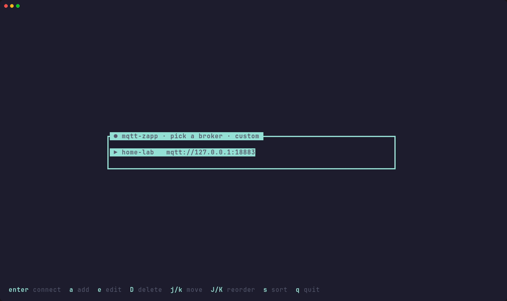

<p align="center">
  
</p>

<h1 align="center">mqtt-zapp</h1>

<p align="center">
  <b>A fast terminal MQTT explorer — browse, watch, diff, chart and publish, right next to your broker.</b>
</p>

<p align="center">
  <a href="https://github.com/13/mqtt-zapp/actions/workflows/ci.yml"></a>
  <a href="https://github.com/13/mqtt-zapp/releases/latest"></a>
  <a href="LICENSE"></a>
  
</p>

<p align="center">
  
</p>

mqtt-zapp is a TUI that works well over SSH: a single static binary you can
copy to a headless box and run there, next to the broker. It is inspired by
the feature set of MQTT Explorer.

## ✨ Features

- 🌳 **Live topic tree:** message and topic counts per level, retained markers, and natural, count or recent sorting.
- 🔍 **Pretty payloads:** JSON is pretty-printed, and the diff shows what changed since the previous message, or since one you mark.
- 🏭 **Sparkplug B:** `spBv1.0/…` payloads are decoded to JSON, so you can search, diff and chart their metrics; metric names from BIRTH replace aliases.
- 📈 **Charts:** plot any numeric field from a topic's history. `c` cycles through the fields, or click a number to chart it.
- ✉️ **Publish:** a form with your `$EDITOR` for the payload, and a per-topic recall of what you sent.
- 🧹 **Retained housekeeping:** delete one retained message, clear a whole subtree, or delete a topic outright.
- 🔐 **Every transport:** mqtt, mqtts with your own CA, websockets (ws and wss), MQTT 3.1.1 and 5, and passwords in the system keyring. MQTT 5 properties (content type, response topic, user properties …) show under the message header.
- 🖱️ **Mouse and clipboard:** click to select, pin and expand, scroll with the wheel, and copy topics and payloads over OSC 52, even through SSH.
- 📦 **Runs anywhere:** a static musl binary, an AppImage, an Arch package or a Debian package.

## 🚀 Quick start

```sh
mqtt-zapp profile add --name home --host 192.168.1.10
mqtt-zapp --profile home
```

Or just run `mqtt-zapp` and pick or add a profile in the picker.

## 📥 Install

Every [release](https://github.com/13/mqtt-zapp/releases/latest) carries
these files, plus a `SHA256SUMS` list.

### Arch Linux

```sh
sudo pacman -U ./mqtt-zapp-0.1.0-1-x86_64.pkg.tar.zst
```

### Debian / Ubuntu

For Debian 12+ and Ubuntu 22.04+:

```sh
sudo apt install ./mqtt-zapp_0.1.0-1_amd64.deb
```

### AppImage

For any x86_64 distro:

```sh
chmod +x mqtt-zapp-0.1.0-x86_64.AppImage
./mqtt-zapp-0.1.0-x86_64.AppImage
```

Without FUSE (some containers and minimal hosts), add
`--appimage-extract-and-run`.

### Static binary

A single file you can copy to a headless host:

```sh
scp mqtt-zapp-v0.1.0-x86_64-linux-musl user@host:mqtt-zapp
ssh user@host chmod +x mqtt-zapp
```

### From source

You need a Rust toolchain, `pkg-config` and the dbus headers for the
keyring: `libdbus-1-dev` on Debian/Ubuntu, `dbus` on Arch.

```sh
git clone https://github.com/13/mqtt-zapp && cd mqtt-zapp
cargo install --path crates/mqtt-zapp
```

Add `--no-default-features` to build without the keyring and without dbus.

> [!NOTE]
> **Passwords are never stored in the config files.** The Arch, Debian and
> source builds can keep them in the system keyring. The AppImage and the
> static binary are built without keyring support, so they ask for the
> password when they connect.

## 🔌 Connecting

```sh
mqtt-zapp                                  # profile picker
mqtt-zapp --profile home                   # saved profile
mqtt-zapp --host 192.168.1.10              # ad-hoc, plain mqtt on 1883
```

To switch brokers while connected, press `b` or click the broker name in the
top bar. The picker opens with the current profile marked `●`. The session
keeps running until you pick another one, and `esc` goes back to it.

### Profiles

In the picker:
- `a` adds a profile, `e` edits the selected one, and `D` deletes it (after a yes/no).
- `J`/`K` move the selected profile down/up, and the order is saved to `profiles.toml`.
- `s` sorts the picker by that custom order, by name or by last used. The choice is remembered in `state.toml`, in `~/.local/state/mqtt-zapp/`, next to the last-used times.

The form covers every field. `space` or `←`/`→` change the protocol and the
password source, and `ctrl-s` saves to `profiles.toml`. A keyring password
typed there goes to the keyring, never to the file.

From the shell:

```sh
# plain mqtt
mqtt-zapp profile add --name home --host 192.168.1.10

# mqtts with a private CA
mqtt-zapp profile add --name secure --host broker.lan --protocol mqtts \
    --ca-file ~/ca.pem

# MQTT 5 (default is 3.1.1)
mqtt-zapp profile add --name five --host broker.lan --mqtt-version 5

# wss (websockets over TLS)
mqtt-zapp profile add --name cloud --host broker.example.com --protocol wss

# ask for the password every time / keep it in the system keyring
mqtt-zapp profile add --name a --host h --user me --password-mode prompt
mqtt-zapp profile add --name b --host h --user me --password-mode keyring
```

The websocket path defaults to `/`. Set a different one in the picker's form,
or edit `ws_path` in `profiles.toml`, for example `ws_path = "/mqtt"`.

## ⌨️ Keys

`?` shows the keys in effect, including your remaps. Type while it is open to
search it; matching rows are highlighted (`esc` clears the search). The publish
form and the search input take typed text and do not use the keymap; the help
lists their keys too.

`c` cycles the chart through the numeric fields; `esc` closes it at any point.

Destructive actions (`x`, `X`, `delete`, `D`) ask first: only `y` confirms, and
any other key, `enter` included, cancels.

<details open>
<summary><b>All keys</b></summary>

| Key | Action | What it does |
|---|---|---|
| `k`, `up` | `up` | Move up |
| `down`, `j` | `down` | Move down |
| `h`, `left` | `collapse` | Collapse, or move to the parent |
| `l`, `right` | `expand` | Expand the node |
| `space` | `toggle_expand` | Toggle expand/collapse |
| `/` | `search` | Filter the tree |
| `p` | `publish` | Open the publish form |
| `tab` | `focus_next` | Switch pane |
| `enter` | `select` | Select |
| `d` | `toggle_diff` | Diff against the previous message (or the marked one) |
| `b` | `brokers` | Switch broker: open the picker (esc returns) |
| `m` | `mark_diff_base` | Mark the shown history entry as the diff base (again: unmark) |
| `?` | `help` | Show the key help; type to search it, matches are highlighted |
| `q` | `quit` | Quit |
| `esc` | `cancel` | Close the chart, else clear the search / close |
| `g` | `top` | Jump to the top |
| `G` | `bottom` | Jump to the bottom |
| `ctrl-d` | `scroll_down` | Scroll the payload half a page down |
| `ctrl-u` | `scroll_up` | Scroll the payload half a page up |
| `y` | `copy_topic` | Copy the topic to the clipboard (OSC 52) |
| `Y` | `copy_payload` | Copy the shown payload to the clipboard (OSC 52) |
| `x` | `delete_retained` | Delete the retained message of the selected topic (asks first) |
| `X` | `clear_retained` | Clear every retained message in the subtree (asks first) |
| `delete` | `delete_topic` | Delete the topic and everything under it: clear their retained messages on the broker, then remove them from the list (asks first) |
| `s` | `sort` | Cycle the tree order: name (natural), message count, most recent; in the picker: custom, name, last used |
| `L` | `expand_all` | Expand the selected node and everything below it |
| `H` | `collapse_all` | Collapse the selected node and everything below it |
| `c` | `chart` | Chart the payload, or cycle through its numeric JSON fields (the charted line is highlighted) |
| `C` | `chart_pin` | Pin the charted series so the next `c` overlays another (again: unpin) |
| `S` | `stats` | Show broker statistics from `$SYS` |
| `a` | `add_profile` | In the picker: add a profile |
| `e` | `edit_profile` | In the picker: edit the selected profile |
| `D` | `delete_profile` | In the picker: delete the selected profile |
| `K` | `move_up` | In the picker: move the selected profile up (custom order) |
| `J` | `move_down` | In the picker: move the selected profile down (custom order) |
| `f` | `freeze` | Freeze the display: only your own keys, clicks and resizes redraw (again: live) |

</details>

### 🔎 Search

`/` filters the tree as you type:
- Every space-separated word must appear, case-insensitively, in the topic path or the latest payload. Each word may be in either.
- `"quoted words"` match as one phrase.
- `ctrl-r` switches the input to a case-insensitive regular expression. An invalid one shows its error and keeps the last valid filter.
- Only the first 64 KiB of a payload is searched.
- Matches are underlined in the tree and in the payload.

### ⚠️ Header warnings

The top bar flags what you should know about:
- `⚠ N dropped`: the UI fell behind a busy broker and skipped N messages.
- `⚠ N topics refused`: N messages on new topics were refused because the tree is at `max_topics`.
- `⚠ unverified tls`: the profile skips TLS certificate checks.
- `⚠ password in cleartext`: a password is sent over plain `mqtt`/`ws`.
- `❄ frozen`: `f` froze the display; press `f` again to go live.

### 🖱️ Mouse

| Click | Does |
|---|---|
| A pane | Focus it |
| A topic | Select it. Click the `▸` marker or the selected row again to expand it |
| A history entry | Pin it |
| A profile in the picker | Select it. Click again to connect |
| The `⧉ copy` button or the topic path on the message header | Copy the topic |
| The `⧉ copy` button or the title on the payload pane | Copy the shown payload |
| A number in the payload | Chart it. Click it again to turn the chart off |
| The broker name in the top bar | Switch brokers |
| A tree row, with the right button | Copy its topic |

The wheel works on the pane under the pointer: it moves the selection in the
tree, scrolls the payload and steps through the history. Copying uses OSC 52. Hold shift
to select text with the mouse.

To select text with the mouse in kitty and other terminals, press `f` first; live updates on the same lines clear a terminal selection.

### ✉️ Publishing

In the publish form, `ctrl-e` opens the payload in `$VISUAL`/`$EDITOR` (or
`vi`), and `ctrl-p`/`ctrl-n` recall payloads sent to that topic in this
session.

## ⚙️ Configuration

`profiles.toml` and `settings.toml` live in `~/.config/mqtt-zapp/`, the XDG
config dir. Set `MQTT_ZAPP_CONFIG_DIR` to use another directory. The UI state file
(`state.toml`) lives in the XDG state dir (`~/.local/state/mqtt-zapp/`); it
follows `MQTT_ZAPP_CONFIG_DIR` when that is set, or set `MQTT_ZAPP_STATE_DIR`
to place it separately.

<details>
<summary><b>settings.toml</b></summary>

```toml
history_depth = 200      # messages kept per topic (default 100)
max_history_mb = 256     # payload bytes kept across all topics' history; each
                         # topic always keeps its latest message (default 256)
max_payload_kb = 16384   # longer payloads are cut and marked truncated; 0: no cap
                         # (default 16384)
max_topics = 200000      # topic levels kept; messages on new topics past it are
                         # refused and counted in the header (default 200000)
auto_expand = 1          # new topics this many levels deep start expanded (default 0)
sort = "name"            # tree order: name (natural), count, recent; `s` cycles
theme = "dark"           # dark, light or mono; NO_COLOR forces mono
timestamp_format = "%H:%M:%S%.3f"   # strftime for the message time

[keys]                   # action name = key; replaces that action's defaults
toggle_diff = "D"
quit = "ctrl-q"
```

A key is either a single character or a name: `esc`, `enter`, `tab`, `space`,
`up`, `down`, `left`, `right`, `home`, `end`, `pageup`, `pagedown`,
`backspace` or `delete`. Either can be prefixed with `ctrl-` or `alt-`.

</details>

## 📄 License

[MIT](LICENSE)
